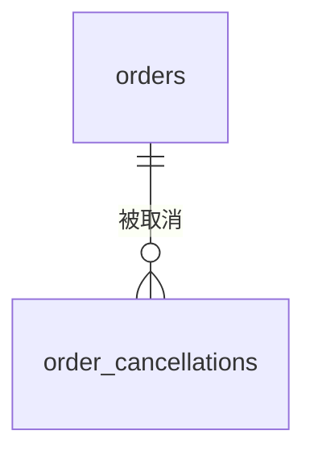

# 資料表設計（`data-model.md`）

**這份是使用者在 ③ 確認、`implementer` 在 ④ 照著建、`reviewer` 在 ⑤ 拿來對照的資料表設計。** 寫成表格，是為了讓他用「看」就能否決：欄位名、型別、長度、能不能空 —— 這幾樣一旦上線有了資料，改起來就是一次 migration 加一次回填。

## 什麼時候寫

做法會新增或修改：資料表、欄位、索引、約束、view／SP／function，或代碼表、存進 DB 的列舉加新的值 → **每個這種做法一節**。都不動 schema 就不寫檔，做法的「資料模型」寫「無」。

## 格式

````markdown
# {feature-id} —— 資料表設計

## A) {跟回傳裡做法 A 同一個標題}

### 新增 `order_cancellations` —— 訂單取消紀錄
| 欄位 | 型別 | 可空 | 預設 | 鍵／索引 | 說明 |
|---|---|---|---|---|---|
| id | bigint identity | 否 | | PK | |
| order_id | bigint | 否 | | FK → orders.id（禁止刪除）、IX | 被取消的訂單 |
| reason_code | varchar(20) | 否 | | | 取消原因代碼（需求決議 2） |
| cancelled_at | datetime2(0) | 否 | sysutcdatetime() | | UTC |

### 修改 `orders`
| 異動 | 欄位 | 改前 | 改後 | 既有資料 |
|---|---|---|---|---|
| 新增 | cancelled_at | — | datetime2(0)，可空 | 既有 12 萬筆全部 NULL，不回填 |
| 改型別 | remark | nvarchar(100) | nvarchar(500) | 只放寬，不截斷 |

### 代碼值（有才寫）
- `OrderStatus` 加 `Cancelled = 9`（`Order.cs:42`；DB 存整數）

### 關聯（兩張以上的表有關聯才畫）


### 落地
- migration：EF Core，`src/Shop.Infra/Migrations/`（依據 `AppDbContext.cs:18`）
- 依據：命名照 `guidelines/sql.md` 的 SQL-NAME-01；稽核欄位照 `orders`（`Order.cs:12-15`）
- 既有資料：{要不要回填、加約束前既有資料符不符合、會不會鎖表 —— 跟做法的「影響：資料=」一致}
- 待確認：{業務上要他決定的，一項一行；沒有寫「無」}

## B) …
````

## 規則

1. **一個做法一節，標題跟回傳裡的做法同一個代號**（`A)`、`B)`）—— `spec.md` 靠代號指到這一節，使用者換做法時 orchestrator 靠它找到那一節。
2. **只寫新增或異動的。** 新表寫全部欄位；既有表只寫異動的那幾欄（改前 → 改後），沒動的不抄。
3. **從業務詞出發。** 表名、欄位名對到 `project-map.md` 的「領域詞彙」與需求決議的用語，避開它標「避用」的別名；「說明」寫業務意義與它對到的需求決議，不寫「訂單編號的編號」這種重複欄位名的話。
4. **照這個 repo 的慣例**：命名、主鍵型別、稽核欄位、軟刪除、時間型別與時區、金額型別與 scale（跟 `spec.md` 談定的精度一致）。依據寫在「落地」那一節（`檔:行` 或規範 id）—— 沒寫依據的慣例，`reviewer` 分不出是照抄還是發明。
5. **每個 FK 寫刪除時怎麼辦**（禁止／連帶刪除／設 NULL）；多對多一定有中介表；查詢會用到的條件寫索引。
6. **既有資料一定要寫。** 既有列的新欄位填什麼、要不要回填、改型別會不會截斷、加 NOT NULL／unique 之前既有資料符不符合。查不出來就寫進「待確認」，**不要假設資料是乾淨的** —— 這一行直接餵給 ⑥ 的不可逆性判斷。
7. **業務決策不替他定。** 長度上限、能不能空、唯一性、保留多久，需求決議沒談到 → 表格裡寫「待確認」，回傳另寫一條「需求缺口：」。
8. **不寫 migration script 全文、不寫連線資訊、不寫真實資料樣本**（筆數可以寫）。DDL 是 `implementer` 照這份表格寫的。
9. **上限約 150 行。** 超過 → 建議做法那一節寫全，其餘做法只寫「新增／修改哪幾張表」一行，回傳的「沒做完」寫明。

## 核准之後

`spec.md` 指到的那一節就是使用者核准過的設計：

- **`implementer`** 照它建（表名、欄位、型別與長度、可空、預設、鍵、索引）。要偏離、或要加這份沒有的表／欄位 → 回 `blocked`，改哪裡由使用者重新確認。
- **`reviewer`** 拿 migration／ORM model／DDL 跟它比，對不上是必修。
- **同一塊功能的下一次迭代**：核准過的節原樣保留，在尾端接著寫 `## 迭代 N：A) …`。
